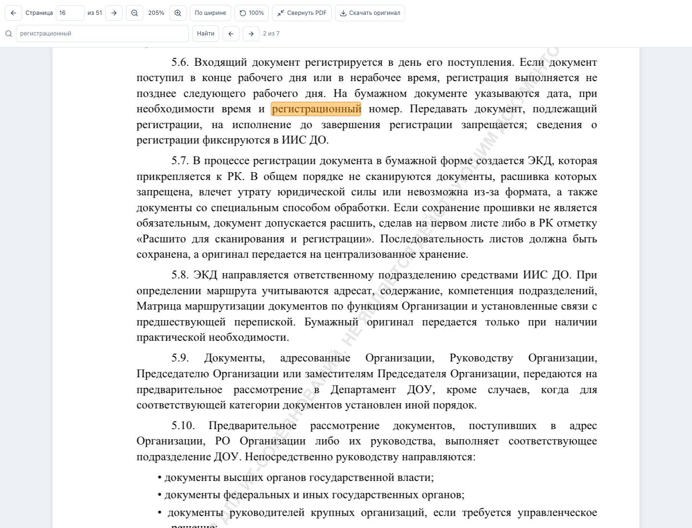
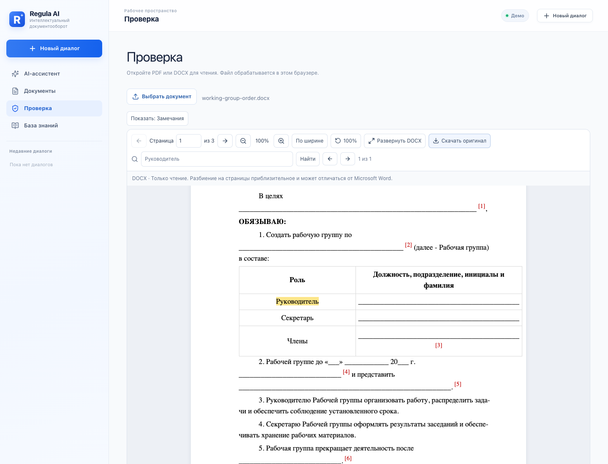
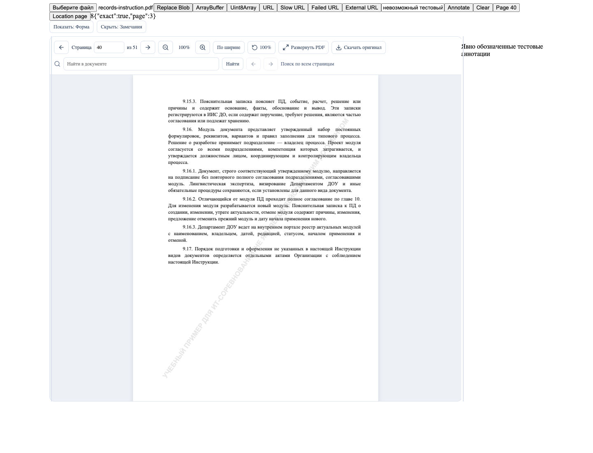

# Regula AI: общий просмотрщик документов, этап 01

## Результат и границы

`src/components/document-viewer/` — единая независимая от страниц оболочка с двумя движками. Режимы `knowledge`, `editor`, `review` задают контекст, а возможности панели управляются через `tools` и `toolbarExtra`. Ни один режим не содержит собственную копию рендерера.

- База знаний: кнопка оригинала открывает как PDF, так и DOCX. Существующие содержание, сведения о пункте, редакции, поиск по базе и нормативные ссылки сохранены. Известная страница и извлечённый текст пункта передаются в `initialLocation`. Если совпадение нельзя найти, показываются известная страница и исходная цитата; координаты не выдумываются.
- Документы: добавлен просмотр **сохранённого** артефакта DOCX. Существующие поля, экранный текстовый предпросмотр, сохранение, проверка и генерация семи модулей сохранены. Несохранённые изменения не выдаются за содержимое артефакта. Нового endpoint генерации временных файлов нет.
- Проверка: выбранный PDF/DOCX читается локально; справа расположена изменяемая и сворачиваемая панель с честным статусом отсутствующего AI. Файл не отправляется на сервер. AI-замечания не имитируются.

## Исходное состояние

Работа выполнена поверх `91317da`, в ветке `codex/pdf-original-viewer`. При старте рабочая папка была чистой; зарегистрирован один Git worktree. Удалённые вершины проверены: текущая ветка `91317da`, main `b7a3640`. Последние изменения добавляли PDF original viewer, корректный MIME module worker и проверки fullscreen. Изучены текущая маршрутизация, сессии, API оригиналов и артефактов, генераторы семи модулей и существующие тесты. Backend не изменялся.

## Библиотеки

| Пакет | Версия | Назначение |
|---|---|---|
| react-pdf | 11.0.0 | Document/Page и управляемые React жизненные циклы PDF.js |
| pdfjs-dist | 6.3.289 | Текстовые слои, worker, извлечение текста; та же версия, что у React-PDF |
| docx-preview | 0.4.1 | DOCX с оригинальным форматированием, таблицами и разделами |
| react-resizable-panels | 4.14.8 | Group/Panel/Separator с текущим API v4 |

`package.json` и `package-lock.json` обновлены. React 19 сохранён. При установке npm audit: 0 уязвимостей. Версия PDF.js согласована с React-PDF вместо прежней 6.4.299, чтобы основной модуль и worker не расходились.

Первичные справочники: [React-PDF](https://github.com/wojtekmaj/react-pdf), [docx-preview](https://github.com/VolodymyrBaydalka/docxjs), [react-resizable-panels](https://github.com/bvaughn/react-resizable-panels).

## Файлы

Новые файлы:

- `src/components/document-viewer/DocumentViewer.tsx` — загрузка, состояние, общие инструменты, скачивание и fullscreen/расширенный режим.
- `PdfViewer.tsx` — React-PDF, оконный рендеринг и поиск по текстовым слоям.
- `DocxViewer.tsx` — изолированный DOCX DOM, приближённые страницы, масштаб, текстовые выделения.
- `ViewerToolbar.tsx`, `ViewerLoading.tsx`, `ViewerError.tsx` — общие элементы управления и состояния.
- `ResizableDocumentLayout.tsx` — два/три слота, границы размеров, клавиатура, сворачивание, вертикальное расположение на узких экранах.
- `types.ts`, `source.ts`, `search.ts`, `index.ts`, `document-viewer.css` — API, безопасная загрузка, поиск, экспорты и стили.
- `hooks/useDocumentSource.ts`, `hooks/useDocumentNavigation.ts`, `hooks/useViewport.ts` — отмена устаревших запросов, публичная навигация и измерение контейнера.
- `src/components/ReviewPage.tsx` — минимальная интеграция File и изменяемых панелей.
- `scripts/pdf-assets.ts` — локальная раздача CMaps/стандартных шрифтов в Vite и включение в сборку.
- `tests/e2e/document-viewer.spec.ts`, `tests/e2e/viewer-logic.spec.ts` — сценарии чтения и ключевая логика.
- `tests/viewer/index.html`, `harness.tsx`, `viewer.spec.ts`, `fixtures/unsafe-content.docx`, `playwright.viewer.config.ts` — отдельная тестовая страница и проверки обновлений/аннотаций/безопасности. Страница не входит в production build.
- Этот отчёт и снимки в `docs/qa/document-viewer/`.

Изменены `src/App.tsx`, `src/components/DocumentsPage.tsx`, `src/features/documents/api.ts`, `src/features/knowledge/KnowledgeViewer.tsx`, `vite.config.ts`, зависимости, обе существующие e2e-спецификации, `playwright.config.ts` и CI. Старые `src/features/knowledge/PdfOriginal.tsx` и `pdf-original.css` удалены: их роль выполняет общий просмотрщик.

## Реальные возможности

### PDF

- Многостраничное чтение, произвольный переход, предыдущая/следующая страница, текущая/общее число.
- Масштаб 25–300%, сброс 100%, автоматическая подгонка по ширине, сохранение относительной позиции при масштабировании.
- Настоящий PDF.js текстовый слой: выделение и копирование; поиск по **всем** страницам, предыдущий/следующий результат, полупрозрачная подсветка.
- Поиск не зависит от регистра и допускает неразрывные пробелы и переносы; совпадения могут пересекать текстовые runs. HTML исходного текста экранируется.
- Canvas и текстовые слои создаются только в окне около viewport, затем размонтируются средствами React-PDF. Лимит каждого canvas — около 8 млн пикселей, DPR не выше 2. Метаданные размеров страниц загружаются без предварительного рисования всех canvas.
- Поиск выполняется последовательно с уступкой управления между страницами; новое действие отменяет применение устаревших результатов. Текст кэшируется на срок жизни документа.
- Worker, CMaps и стандартные шрифты обслуживаются с собственного origin, без CDN. Прежняя настройка MIME `.mjs` nginx сохранена.
- В React-PDF 11 явно отключён Suspense на Document/Page: загрузка дальней страницы не скрывает весь движок и не обнуляет прокрутку.

### DOCX

- Оригинальная структура абзацев, стилей, таблиц, заголовков, списков, колонтитулов и ручных/сохранённых разрывов средствами docx-preview.
- Только чтение, масштаб, подгонка по ширине, прокрутка, приближённая нумерация страниц, поиск, навигация к цитате или существующей закладке.
- Новые Blob корректно заменяют DOM; устаревший асинхронный результат не вставляется. При неизменном `documentId` сохраняются масштаб и позиция чтения. Есть внешний индикатор `updating`.
- Данные изображений/шрифтов встроены как data URLs; старые DOM и observers освобождаются при размонтировании. CSS документа не распространяется на приложение.

Оба движка скачивают исходные байты через один механизм; временные Blob URL отзываются после начала скачивания и при размонтировании.

## Подключение

Публичные экспорты находятся в `src/components/document-viewer/index.ts`. В примерах пути даны относительно `src`.

```tsx
import { useMemo, useRef } from 'react'
import {
  DocumentViewer, ResizableDocumentLayout,
  type DocumentViewerHandle,
} from './components/document-viewer'

const viewer = useRef<DocumentViewerHandle>(null)
const target = useMemo(() => ({
  page: section.pageStart || undefined,
  quote: section.text,
}), [section])

// База знаний: loadLocalSource использует существующий requestResponse/session.
<DocumentViewer
  ref={viewer}
  source={version.originalUrl}
  filename={version.filename}
  format={version.fileType} // здесь только pdf | docx; TXT остаётся в текстовом reader
  documentId={version.id}
  initialLocation={target}
  mode="knowledge"
/>

// Конструктор: передавать новый Blob; постоянный ID сохраняет позицию/масштаб.
<DocumentViewer
  source={previewBlob}
  documentId={project.projectId}
  filename="preview.docx"
  mode="editor"
  updating={previewIsUpdating}
/>

// Проверка: File не нужно загружать на сервер ради чтения.
<ResizableDocumentLayout after={{
  id: 'issues', label: 'Замечания', content: issuesPanel,
  defaultSize: '25%', minSize: '180px',
}}>
  <DocumentViewer ref={viewer} source={file} mode="review" />
</ResizableDocumentLayout>

await viewer.current?.goToPage(12)
await viewer.current?.goToLocation({page: 12, quote: 'Точная цитата'})
const result = await viewer.current?.highlightAnnotation({
  id: 'issue-from-review-service', severity: 'warning',
  message: 'Объяснение замечания из сервиса проверки',
  location: {page: 12, quote: 'Точная цитата'},
  sourceReference: '#knowledge/sections/known-section-id',
})
// result.exact === false: использовать известную страницу и показанный текст,
// не представлять приблизительное местоположение как точное совпадение.
viewer.current?.clearHighlight()
```

Поддерживаются URL-строка, File, Blob, ArrayBuffer, Uint8Array. Входные массивы копируются перед передачей PDF.js, чтобы worker не отсоединил принадлежащий вызывающему коду буфер. Формат проверяется по сигнатуре, а не только по расширению. ZIP без структуры DOCX будет отклонён движком DOCX.

Не создавайте новый `documentId` при каждом обновлении Blob. Меняйте его при переходе к другому документу/редакции. Стабилизируйте объект `initialLocation` через useMemo: это явная цель перехода. Та же цель не применяется заново при обновлении Blob одного документа. Для вызова навигации после загрузки можно использовать `onReady`.

Можно скрывать инструменты через `tools={{search: false, download: false, fullscreen: false}}`, добавлять собственные через `toolbarExtra`, подписываться на `onReady`, `onLocationChange`, `onError`. `loadSource(url, signal)` позволяет внедрить другой авторизованный загрузчик, возвращающий Blob; ответственность за его политику доступа остаётся у вызывающего раздела.

`DocumentAnnotation` отделяет severity/message/metadata/sourceReference от семантической `location` и необязательных нормализованных прямоугольников `visual`. Публичная навигация возвращает `NavigationResult`, чтобы вызывающий код различал точное найденное место и fallback.

## Безопасность

- URL по умолчанию разрешены только на текущем HTTP(S) origin, с запрещёнными перенаправлениями. Cookies, сессия, ошибки доступа и CSRF-инфраструктура используются из `src/shared/http.ts`.
- Максимальный исходный файл — 50 МБ, в том числе для stream без Content-Length. При смене источника fetch отменяется AbortController.
- Права FastAPI на оригиналы и артефакты не менялись. Ограниченные оригиналы не публикуются через статическую раздачу.
- PDF: отключены annotation links, XFA, eval и WebAssembly; политики CSP приложения не ослаблены.
- DOCX: iframe `sandbox="allow-same-origin"` без разрешения выполнения скриптов и переходов; отдельная CSP запрещает сетевые обращения и формы, разрешает стили и локальные data images/fonts. Узлы создаются фабрикой в документе iframe. Активные теги/обработчики удаляются, внешние ссылки отключены, HTML altChunks и comments не исполняются.
- Никто не отправляет документы во внешние сервисы; серверные генераторы, исходники и бизнес-правила сохранены.

## Проверки

Реальные файлы: `api/knowledge/sources/records-instruction.pdf` (51 страница), `api/templates/sources/working-group-order.docx` (4 исходные таблицы), сгенерированный через API working-group DOCX. Отдельная fixture на основе этого DOCX содержит опасную ссылку и HTML altChunk для проверки изоляции.

- `python -m pytest -q api/tests`: **23 passed**. Покрыты существующие модули, сессии, права, нормативный корпус и интеграция.
- `npm run build`: TypeScript и Vite успешно. Есть информационные предупреждения Vite о `use client` в React-PDF и размере PDF chunk; сборка не падает.
- `npm run test:e2e`: **8 passed**. Поиск/переходы/масштаб/fullscreen, настоящее копирование выделенного PDF-текста в clipboard, точное сравнение скачанных PDF/DOCX с исходниками, таблицы/стили DOCX, PDF → DOCX → PDF, повторное открытие, узкий экран, повреждённый файл, отсутствие pageerror и ошибок консоли приложения; существующие сценарии поиска, чатов, сохранения правок и генерации сохранены.
- `npm run test:viewer`: **3 passed**. Обновления Blob, ArrayBuffer/Uint8Array в обоих движках, сохранение позиции на странице 40, ограниченное число canvas, fallback и очистка аннотации, переход по page-only location, размеры/сворачивание трёх панелей, отмена медленной URL-загрузки, отказ доступа, недоступный API (503), повторную загрузку, запрет внешнего URL и восстановление, блокировка javascript/altChunk/внешних обращений DOCX.
- Дополнительно e2e против production preview: **8 passed**. `REGULA_TEST_CSP=1` применяет к тесту чтения точную CSP из `deploy/Caddyfile` без её изменения.
- Визуально просмотрены снимки PDF fullscreen, исходного DOCX с таблицей и ленивого перехода на страницу 40. Снимки сохранены в `docs/qa/document-viewer/`.

`npm run test:e2e` ожидает работающие frontend/API (локально Vite :5173, FastAPI :8000 или REGULA_TEST_URL). `npm run test:viewer` сам поднимает Vite :5175 и использует отдельную dev-страницу/перехваченные fixture-запросы. В CI оба набора запускаются после сборки. Проверка чистоты консоли выполняется без trace snapshotter: его попытки внедрить скрипт в sandboxed srcdoc блокируются браузером (отдельно сопоставлены запуски с tracing и без него). Для системного Chrome можно задать `REGULA_CHROME_PATH`.

## Снимки проверенного интерфейса







## Ограничения

- DOCX в браузере не является юридически точным отображением Microsoft Word; автоматически переразбивать длинные тексты на листы библиотека не умеет. Интерфейс явно предупреждает об этом.
- DOCX строит полный DOM документа; виртуализация реализована для PDF. Очень тяжёлые DOCX могут потребовать больше времени и памяти.
- Нет OCR: поиск PDF требует текстового слоя. Парольные PDF показывают ошибку; ввода пароля нет. Нестандартные документы могут отличаться шрифтами/переносами.
- Точное совпадение цитат не гарантируется при переносах с дефисом, отличиях извлечения или сканах. Применяется честный fallback.
- `textOffsetStart/End`, PDF sectionId и `visual.rects` подготовлены как интерфейсы расширения, но не используются для рисования самостоятельного слоя замечаний. Реальная текущая подсветка основана на найденной цитате; DOCX также поддерживает существующие bookmark IDs. Без точного совпадения чужой фрагмент не подсвечивается.
- AI-проверка, принятие правок, Word-редактор, живая серверная генерация DOCX по полям, новый трёхколоночный интерфейс базы знаний и перестройка форм остаются следующими этапами, как предусмотрено ТЗ.
- Docker/VPS развёртывание не выполнялось; проверены локальная сборка, backend и браузерные сценарии. PR и push не создавались.

Изменения сохраняются одним коммитом с темой `Add universal PDF and DOCX document viewer` в текущей ветке; идентификатор указан в итоговом сообщении.
