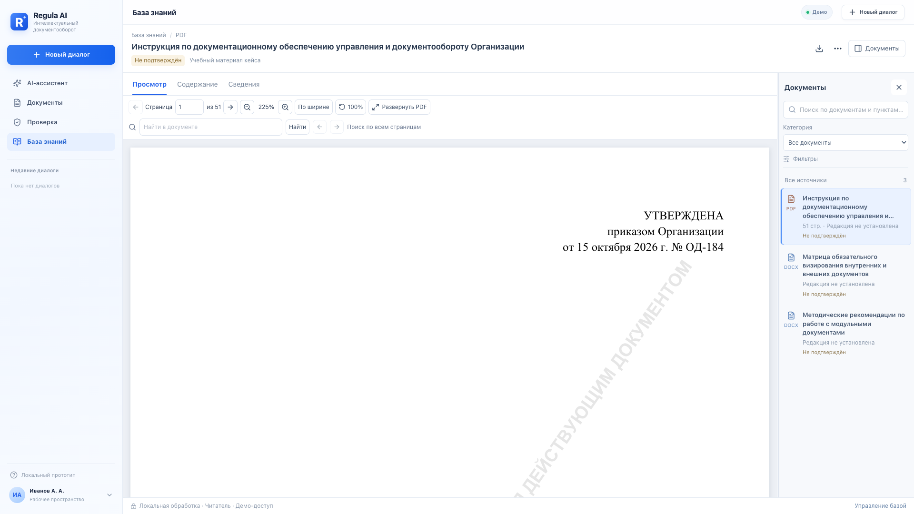
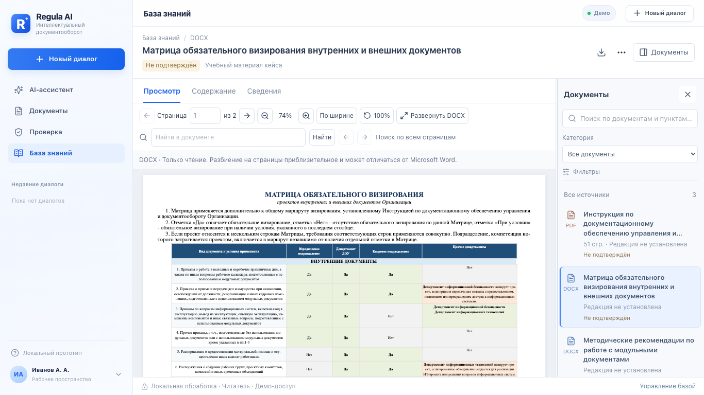
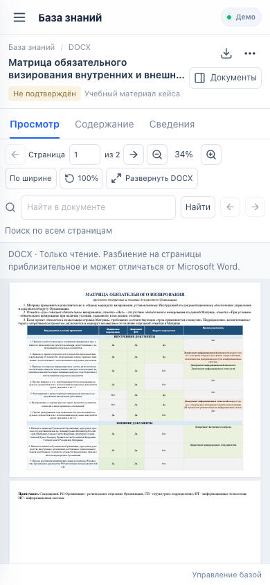

# Regula AI — этап 02: рабочее пространство базы знаний

## Реализованный интерфейс

Существующий глобальный Sidebar с логотипом, чатами, основными разделами, профилем и мобильным меню сохранён. Внутри основной области — широкая панель оригинального документа и компактный проводник справа. Отдельного экрана каталога больше нет: выбор файла обновляет центр на месте.

- По умолчанию выбирается первый доступный документ из ограниченной сервером страницы каталога. Прямая ссылка имеет приоритет над автоматическим выбором.
- Компактный заголовок показывает название, фактический формат, статус выбранной редакции и происхождение материала. Есть скачивание оригинала, меню действий и переключатель списка файлов.
- «Просмотр» использует общий DocumentViewer этапа 01 для PDF/DOCX. «Содержание» и «Сведения» не размонтируют его; страница, масштаб и поиск сохраняются, оригинал повторно не запрашивается.
- TXT читается как настоящий UTF-8 оригинал через авторизованный загрузчик, с переносами строк и прокруткой. Он не подменяется извлечёнными пунктами.
- Содержание строится из backend SectionSummary: иерархия, сворачивание/раскрытие, поиск по заголовкам и номерам, известные страницы, выбранный пункт и действия AI. Поиск сохраняет родительские узлы; пункты не привязываются к выдуманным координатам.
- Выбор пункта открывает оригинал на известной странице/найденной цитате. Одновременно доступен точный извлечённый текст или таблица пункта, постоянная ссылка и передача в чат. При сбое оригинала можно перейти к этому представлению.
- Сведения включают реальные метаданные документа и выбранной редакции, историю редакций, даты, ACL, происхождение, имя файла и дополнительные технические данные под раскрываемым блоком. Последняя загрузка не объявляется действующей редакцией.
- Проводник справа содержит поиск, категории API, фильтры статуса/формата, сортировку и компактные строки. Результаты по названию/описанию/владельцу и совпадения FTS5 в пунктах показываются отдельно. У обоих списков серверная пагинация по 20 результатов; весь каталог не выгружается.
- Поиск имеет debounce 300 мс. Fetch отменяется AbortController, устаревшие ответы не изменяют новый результат.
- Правая панель начинается с 288 px, ограничена 260–420 px, изменяется мышью и клавиатурой, сворачивается и открывается повторно. Выбранная ширина хранится в sessionStorage. При ширине экрана до 1100 px список доступен через выдвижную modal-панель; документ получает основное пространство.
- Административная загрузка использует прежний UploadDialog. После загрузки выбирается именно новая редакция, список обновляется и его фильтры сбрасываются, чтобы новый источник не скрывался старым поиском. Для читателей действия загрузки/новой редакции/индексации отсутствуют. Вход и выход по существующему механизму обслуживания сохранены.

## Навигация и AI

Совместимость со старыми `#knowledge/documents/{id}` и `#knowledge/sections/{id}` сохранена. Документная ссылка может содержать `?version={id}`; секционная ссылка сама однозначно определяет редакцию. Необязательный `tab=contents|info` выбирает вкладку. Переключение файлов/редакций/пунктов добавляет запись истории, вкладки заменяют текущую запись; прокрутка и масштаб историю не меняют.

`hashchange` и `popstate` синхронизируют выбранный источник с URL. При загрузке другого источника старое содержимое скрывается за состоянием загрузки; при ошибке источник не подменяется первым документом каталога. Переход из цитаты AI выбирает документ и редакцию из настоящего KnowledgeCitation.

Кнопка вопроса по пункту передаёт исходную KnowledgeCitation в прежний onAsk. Для вопроса о документе используется реальная цитата первого извлечённого пункта выбранной редакции и документная формулировка запроса. Чат явно сообщает, что закреплены редакция и начальный пункт; не утверждает, что весь файл был передан LLM. Новая LLM и серверный AI-анализ не подключались.

## API: минимальное дополнение

Обнаруженное ограничение: существующий FTS5 возвращает пункты, но отдельного поиска каталога по описанию/владельцу нет. К существующему `GET /api/knowledge/documents` и ListArgs добавлен необязательный `q` (до 500 символов). Это буквальный поиск подстроки по названию, описанию и владельцу без учёта регистра, включая кириллицу. Параметры SQL связаны, `%` и SQL-операторы не исполняются. ACL и фильтры применяются до подсчёта и пагинации. Существующий `/search` и его ранжирование FTS5 сохранены.

Другие endpoint, миграции, модель доступа, оригиналы, проверка SHA-256, cookie/CSRF, генераторы семи DOCX-модулей и AI-инструменты не переписаны. Новых зависимостей нет.

## Структура файлов

Новые компоненты и логика в `src/features/knowledge/`:

- `KnowledgeWorkspace.tsx` — композиция центра и правой панели, действия источника.
- `KnowledgeFilePanel.tsx` — каталог, поиск, фильтры и две серверные пагинации.
- `KnowledgeDocumentPanel.tsx` — вкладки, общий просмотрщик и fallback.
- `KnowledgeTableOfContents.tsx` — дерево backend-разделов.
- `KnowledgeDocumentInfo.tsx` — сведения и история редакций.
- `KnowledgeSectionExcerpt.tsx` — исходный пункт/таблица и действия с цитатой.
- `KnowledgeTextOriginal.tsx` — локальный текстовый оригинал.
- `Highlight.tsx`, `routing.ts`, `hooks/useKnowledgeDocument.ts` — выделение выдачи, маршруты и отменяемая загрузка источника с переиспользованием метаданных.

Изменены:

- `KnowledgePage.tsx` — компактный контроллер URL, роли и прежних диалогов.
- `api.ts` — q каталога и AbortSignal для чтения, включая постраничные sections/versions.
- `knowledge.css` — новая компоновка и адаптивные стили вместо старого каталога.
- `UploadDialog.tsx` — уточнены доступные названия существующих полей, механизм загрузки сохранён.
- `src/App.tsx` — активность базы знаний, Back/Forward и документный вариант вопроса AI.
- `src/components/document-viewer/ResizableDocumentLayout.tsx`, `index.ts`, `document-viewer.css` — ограничение максимальной ширины, публичный toggle/close, сохранение ширины и drawer. Прежнее расположение stacked-панелей в остальных разделах остаётся по умолчанию.
- `hooks/useViewport.ts` общего просмотрщика — игнорирование нулевых размеров скрытой вкладки.
- `api/knowledge/models.py`, `service.py` — необязательный q каталога.
- `api/tests/test_knowledge.py`, браузерные тесты, README и документация API.

Старый `KnowledgeViewer.tsx` удалён: экран отдельного просмотра заменён компонентами рабочего пространства. PDF/DOCX-код в knowledge не копировался.

## Проверки

- TypeScript и production build Vite: успешно. Остались информационные предупреждения React-PDF о директиве use client и размере PDF chunk.
- `python -m pytest -q api/tests`: **24 passed**, включая новый тест поиска метаданных с кириллицей, ACL, пагинацией, ограничением длины и буквальными спецсимволами.
- `npm run test:e2e`: **19 passed** на production preview, включая прежние проверки документов/чата/PDF и новые проверки рабочего пространства.
- `npm run test:viewer`: **3 passed** для общего движка этапа 01 после расширения панелей.
- Реальные браузерные проверки PDF-инструкции (51 страница) и DOCX-матрицы на 1920×1080, 1440×900, 1366×768, 1024×900 и 390×844: колонки, горизонтальное переполнение, кнопки, drawer и глобальное мобильное меню. Снимки сохранены в `docs/qa/knowledge-workspace/`.
- Проверены DOCX-рекомендации, п. 2.1, вопросы AI по пункту и документу, перенос цитаты, clipboard-ссылка и скачивание.
- Проверены повторный показ вкладок без нового GET оригинала, сохранение страницы 12/масштаба 100%, изменение и восстановление ширины, Back/Forward, старые ссылки и защита от запоздавшего поискового ответа.
- На отдельном локальном API с временной базой фактически выполнены вход администратора, загрузка ограниченного TXT, добавление второй редакции, возврат к первой и открытие старого пункта, 22 дополнительных restricted-фикстуры для серверной пагинации. После выхода оригинал/метаданные недоступны читателю. Учебный корпус приложения не заменялся тестовыми документами.
- Проверено отсутствие выдуманных файлов при 503 каталога и извлечённое представление с последующим восстановлением при сбое оригинала.

Административный e2e требует ключа `REGULA_TEST_ADMIN_TOKEN` либо существующего `REGULA_KNOWLEDGE_ADMIN_TOKEN` и должен запускаться на изолированной тестовой базе. В CI используется одноразовый Compose stack. Без ключа этот сценарий явно пропускается; в локальном проверенном прогоне ключ был задан. Ключ не попадает в исходники или браузерное хранилище.

## Проверенные снимки

## Ограничения

- DOCX сохраняет форматирование средствами docx-preview, но разбиение на страницы приблизительное; предупреждение остаётся в общем просмотрщике.
- При переключении вкладок состояние чтения сохраняется. Смена документа/редакции загружает новый оригинал. Пересечение breakpoint desktop/drawer пересоздаёт внутреннюю компоновку и может сбросить локальную позицию/масштаб просмотра.
- Без точного совпадения цитаты используется известная страница и извлечённый текст; OCR и восстановление неизвестной геометрии не добавлены.
- FTS5 остаётся поиском совпадений, а не AI-проверкой применимости. Все материалы кейса остаются синтетическими, со статусом из API.
- Поиск метаданных — буквальная подстрока; морфология и релевантность применяются отдельным существующим FTS5 к пунктам.
- Авторизация остаётся демо-механизмом проекта. Корпоративный SSO, сравнение редакций, новая LLM и переработка других разделов не входят в этап.
- Проверка выполнена локально. Push, PR и развёртывание не выполняются автоматически в рамках этого этапа.

Коммит этапа указан в итоговом сообщении; стартовая вершина — `9dcd017`, рабочая ветка — `codex/knowledge-workspace`.
